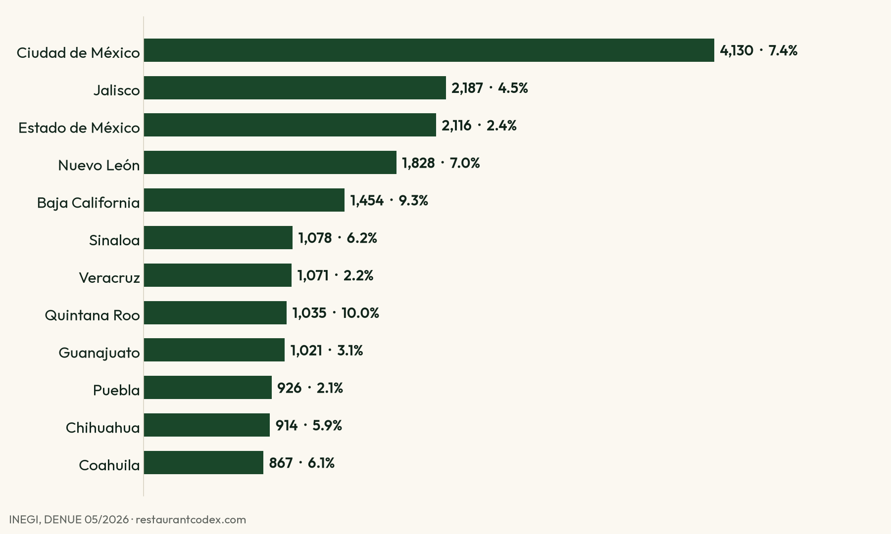

# Mexico's restaurants in numbers (DENUE 05/2026)

Counts of Mexico's **741,499 restaurants, cafés and places that prepare food for immediate consumption** (SCIAN 7225) by state, municipality, type and staff size, plus a floor count of multi-location restaurant groups. Processed from INEGI's business directory, DENUE edition 05/2026 (published 2026-05-20).

Full write-up with charts and context: **https://www.restaurantcodex.com/insights/mexico-restaurant-industry-data-2026**
En español: **https://www.restaurantcodex.com/es/insights/mexico-restaurant-industry-data-2026**

## Key figures

- 741,499 restaurant establishments; 32,361 bars and cantinas (SCIAN 7224) are counted separately and not included.
- 88.7% employ 0 to 5 people. Only 27,709 (3.7%) employ 11 or more.
- Restaurants with 11+ staff: Mexico City 4,130, Jalisco 2,187, State of Mexico 2,116, Nuevo León 1,828.
- Highest share of 11+ restaurants: Quintana Roo 10.0%, Baja California 9.3%, Baja California Sur 8.4%. Lowest: Tlaxcala 1.1%, Oaxaca 1.3%.
- Full-service (à la carte or set menu) is 9.8% of establishments but 42.6% of those with 11+ staff.
- At least 875 company-named groups run 2 to 15 restaurants (3,129 establishments); 73.3% operate in one state. 68 groups run 16 or more.

## Files

| File | What it holds |
|---|---|
| `data/by_state.csv` | Establishments per state, those with 11+ staff and their share |
| `data/by_type.csv` | Establishments per SCIAN 7225 class (Spanish and English names), 11+ count and share |
| `data/by_state_type_staff.csv` | Full table: state x class x staff band |
| `data/eleven_plus_by_municipality.csv` | Restaurants with 11+ staff per municipality |
| `data/groups_by_home_state.csv` | Multi-location groups by home state and size band (floor count) |
| `data/summary.json` | Headline figures |
| `scripts/mexico_restaurants_2026.py` | Reproduces every file from the DENUE bulk CSVs |

## Method

Source: INEGI, Directorio Estadístico Nacional de Unidades Económicas (DENUE) 05/2026, bulk download of sector 72 (https://www.inegi.org.mx/app/descarga/?ti=6). We keep SCIAN class 7225. Staff size is the band INEGI records per establishment; "11+" adds the bands from 11-30 upward.

Groups: DENUE records a legal name (razón social) for about one in eight establishments, mostly larger ones, and many are a person's name. We count a group only when the legal name reads as a company (Operadora, Grupo, Restaurantes, Corporativo, Alimentos and similar) and appears at two or more establishments. That is a floor, not a census: groups with one company per location, franchisees and small groups without a recorded legal name are missed.

## License and citation

Processed data: CC BY 4.0. Please credit **INEGI, DENUE 05/2026** as the original source and **Restaurant Codex (restaurantcodex.com)** for the processing. INEGI's own data is published under its Términos de Libre Uso de la Información.

---

## Los restaurantes de México en cifras

Conteos de los **741,499 restaurantes y cafeterías de México** (SCIAN 7225) por estado, municipio, tipo y rango de personal, y un conteo mínimo de grupos con varias sucursales, a partir del DENUE 05/2026 del INEGI. El análisis completo, con gráficas: https://www.restaurantcodex.com/es/insights/mexico-restaurant-industry-data-2026

Datos procesados con licencia CC BY 4.0: cita al INEGI (DENUE 05/2026) como fuente original y a Restaurant Codex por el procesamiento.
